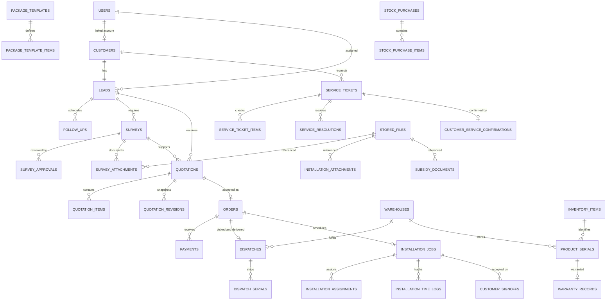

# SunPower Solutions database model

This document describes the SQLite workflow foundation and persistent CRM.
The schema is an additive upgrade to the existing authentication and customer
database; it preserves existing users and legacy CRM records. The official
operational source is
[`docs/requirements/Solar_Installation_Management_System.pdf`](./requirements/Solar_Installation_Management_System.pdf).

## Migrations

Migrations live in `server/src/database/migrations/` and are registered by
`server/src/database/migrate.js`.

| Version | Migration | Purpose |
| --- | --- | --- |
| 1 | `core_identity_and_legacy_crm` | Preserves/extends `users`, creates identity permissions and audit records, and retains CRM tables. |
| 2 | `relational_business_workflows` | Adds CRM lead/follow-up relationships and survey, sales, warehouse, installation, file metadata, and financial tables. |
| 3 | `workflow_controls_warranties_and_reporting` | Adds payment, survey, quotation, stock, dispatch, warranty, service controls, and reporting views. |
| 4 | `profitability_cost_completeness` | Prevents unknown purchase/payroll costs from appearing as zero in profitability reports; removes the illustrative seed wage rate. |
| 5 | `service_resolution_warranty_validation` | Ties service resolutions to ticket serials and validates covered repairs against an active in-term warranty. |
| 6 | `customer_lead_pipeline` | Adds canonical lead stages and keeps them synchronized with legacy CRM status fields. |
| 7 | `survey_management` | Adds customer/site linkage, Surveyor assignment and appointments, survey qualification/findings, visit status, submission metadata, and explicit review actions. |
| 8 | `operational_workflows` | Adds quotation response/revision history, product mappings and reorder levels, commissioning/service fields, and full-payment checks. |
| 9 | `stock_reservation_balance` | Corrects stock-balance trigger handling for reservations while preserving append-only stock movements. |

`schema_migrations` records the applied version, name, and timestamp. Pending
migrations run in ascending order, each in its own transaction. A failed
migration rolls back and reports its version. The runner enables and verifies
SQLite foreign-key enforcement, checks foreign-key integrity after each
migration, rejects unknown versions and migration-name mismatches, and rejects
gaps in migration history. Existing authentication rows are not dropped or
replaced.

The former `customer_follow_ups` table is retained as
`customer_follow_ups_legacy_v1`; its rows are copied to canonical
`follow_ups`. A compatibility view and write triggers preserve the existing
CRM service's `customer_follow_ups` interface. The seven CRM stages are stored
on `leads.stage`; compatibility triggers map Survey Pending/Quotation/Converted
to the historical Survey Scheduled/Quoted/Won values in `leads.status` and
`customers.lead_status`. Lead source and Sales assignment are stored on
`leads`; each customer has one uniquely related lead. New customer and
registration API records require a supported category, On-Grid or Off-Grid
preference, and a 1–5 kW capacity. Existing legacy profiles remain nullable
until completed, without inventing their missing values.

### Table inventory

| Area | Tables |
| --- | --- |
| Migration and identity | `schema_migrations`, `users`, `permissions`, `role_permissions`, `audit_logs` |
| CRM | `customers`, `leads`, `follow_ups`; archived legacy table `customer_follow_ups_legacy_v1` |
| Surveys | `surveys`, `survey_attachments`, `survey_approvals` |
| Sales | `package_templates`, `package_template_items`, `quotations`, `quotation_items`, `quotation_revisions`, `orders`, `payments` |
| Warehouse | `warehouses`, `inventory_items`, `stock_balances`, `stock_movements`, `product_serials`, `dispatches`, `dispatch_serials` |
| Installations | `installation_jobs`, `installation_assignments`, `installation_time_logs`, `installation_checklists`, `installation_attachments`, `customer_signoffs` |
| Warranty | `warranty_rules`, `warranty_records` |
| Service | `service_tickets`, `service_ticket_items`, `service_resolutions`, `customer_service_confirmations`, `service_attachments` |
| Finance | `invoices`, `invoice_items`, `stock_purchases`, `stock_purchase_items`, `expenses`, `technician_payroll_entries`, `subsidy_cases`, `subsidy_documents` |
| Shared file/demo metadata | `stored_files`, `demo_seed_batches`, `demo_seed_records` |

`customer_follow_ups` is a compatibility view, not an additional canonical
table. Reporting views are `v_customer_equipment_serials`,
`v_quotation_totals`, `v_project_profitability`, and
`v_lead_workflow_summary`.

## Tables and relationships

### Identity and CRM

- `users` is the pre-existing authentication table. Migrations add missing
  optional profile columns without replacing its rows or password hashes.
- `permissions` and `role_permissions` store the coarse role permission map.
  `audit_logs` records actor, action, entity, optional JSON details, and time.
- `customers` stores contact/address and solar requirement data. `linked_user_id`
  links an authenticated customer account; existing accounts can retain an
  unset category or system requirement until collected.
- Each `leads` row references one customer; a unique `customer_id` gives the
  current CRM one lead per customer. `leads.stage`, `source`, `assigned_to`,
  and `notes` hold the sales workflow. `follow_ups` references a lead and its
  responsible/creating users, and records due time, notes, and completion.
- `/api/customers` provides role-protected customer/lead create, read, update,
  soft-archive, search, filters, sorting, and pagination. The CRM marks
  synthetic records through `demo_seed_records` and defaults to live records.
  Sales can work only unassigned or self-assigned leads; customers can access
  only their own linked profile through `/api/customers/me`.

### Surveys and sales

- `surveys` reference both a lead and its matching customer, and store the site
  address, assigned Surveyor, scheduled appointment, visit state, initial
  qualification (shadow-free roof area, monthly bill, grid suitability,
  requirements, observations), physical findings (roof direction and tilt,
  cable distance, available area, site condition, shading, and technical
  notes), submission details, and approval state. Migration 7 backfills
  customer/site values for existing surveys and adds a trigger that keeps the
  customer consistent with its lead.
- `survey_approvals` references a survey and records the reviewer, action,
  decision, comments, and time. The review action distinguishes approval,
  rejection, and correction requests. `survey_attachments` links survey
  records to `stored_files`; photograph bytes live in managed filesystem
  storage, not SQLite.
- `package_templates` describe Solar Panel Set, On-Grid, Off-Grid, and separate
  installation-service BOMs. `package_template_items` holds configurable
  components, optional quantities, and units. Active templates must contain
  the required components; Off-Grid additionally requires a large battery.
  No standard wattage, component ratio, package price, or official quantity is
  implied.
- `quotations` reference a lead and a survey belonging to that same lead.
  `quotation_items` contain configurable descriptions, quantities, units, and
  optional prices and inventory product mappings. `quotation_revisions`
  snapshots each saved quote version. Customers can accept or decline a
  released quotation; accepted quotes can be handed off as orders. A quote
  cannot be released until its survey is approved.
- `orders` reference a quotation. Confirmation automatically creates the
  corresponding `dispatches` picking record and `installation_jobs` schedule
  record. `payments` records advance or full payments. Payments cannot exceed
  the configured quote balance. Installation cannot start until the configured
  advance requirement or the fully priced quote's full payment has been
  recorded; no fixed advance percentage is assumed.

### Warehouse and installation

- `warehouses` contain locations; `inventory_items` define SKU/product types.
  Inverters, batteries, and charge controllers must be serial-tracked.
- `stock_balances` are updated by append-only `stock_movements`. A
  `product_serials` row has a globally unique serial number and references its
  product and warehouse.
- `dispatches` reference an order and warehouse. `dispatch_serials` associate
  unique serials with a dispatch and record completed delivery time. The
  warehouse workflow reserves mapped BOM quantities, verifies that each
  scanned serial is reserved for that dispatch, and records delivery. Delivery
  updates serial state and starts the applicable warranty.
- `installation_jobs` reference orders. `installation_assignments` and
  `installation_time_logs` reference technician users; checklists and
  attachments reference jobs. `customer_signoffs` links a job, its customer,
  and optional signature file. The current customer portal records notes and
  sign-off time but does not capture/upload a signature image.

### Warranty, service, and finance

- `warranty_rules` stores the specified terms: panels 20 years, inverter 2
  years, battery 2 years. Charge-controller duration is `NULL` and explicitly
  marked unspecified. `warranty_records` can only start on the completed
  delivery date for its serialized product.
- `service_tickets` reference customers and optionally an order.
  `service_ticket_items` link equipment serials, `service_resolutions` record
  coverage and charges for a ticket serial, and `customer_service_confirmations`
  require the ticket's customer to confirm before final closure.
  `service_attachments` links tickets to stored files. A covered resolution
  requires an active in-term warranty; the charge-controller rule remains
  unspecified and cannot be treated as covered by this rule.
- `invoices` and `invoice_items` hold billable lines; `stock_purchases` and
  `stock_purchase_items` record procurement; `expenses` and
  `technician_payroll_entries` capture project costs. `subsidy_cases` and
  `subsidy_documents` are schema only; no operational subsidy API or UI is
  currently connected. Amounts/rates are configurable and are not seeded as
  official prices, subsidy values, or wage rates.

### Storage, demo provenance, and reporting

- `stored_files` holds metadata and a normalized relative storage key, not file
  content. Attachment tables reference it. `writeManagedFile` in
  `server/src/services/fileStorage.js` writes outside SQLite under a caller
  supplied root, rejects traversal, and uses exclusive file creation.
- `demo_seed_batches` and `demo_seed_records` mark synthetic records and let
  reporting distinguish them from operational data.
- `v_customer_equipment_serials` joins delivered customer serials and warranty
  information; `v_quotation_totals` calculates totals only for fully priced
  quotes; `v_project_profitability` aggregates available invoice/quote revenue
  and recorded purchase, expense, and payroll costs; its `costs_complete` flag
  and nullable cost/profit fields prevent unknown purchase costs or wages from
  being treated as zero. `v_lead_workflow_summary` summarizes lead activity.
  Missing/non-specified values remain `NULL` rather than being represented as
  official performance.

### Operational API and role scope

The authenticated workflow API is mounted at `/api/operations`. It provides
order/payment handoff, stock receipt and purchase receiving, dispatch/picking,
installation scheduling and completion, service and warranty lookup, invoices,
expenses, payroll, and profitability reports. Route role middleware limits
each workflow to its responsible roles. Service methods additionally scope
technicians to assigned jobs and customers to their own orders, installations,
and service records. Customer summary data is exposed through
`/api/operations/customer-records`; customer payment details in the portal are
totals (paid and outstanding), not a detailed transaction ledger.

Admin and staff operational workspaces are connected to these APIs. Admin
dashboard operating-scale KPIs and records marked as synthetic remain
demonstration data, not live operational totals. Workflows use persisted,
user-entered values and do not infer official prices, quantities, costs, or
company performance.

### Relationship diagram



## Business constraints

- Customer category is restricted to `Home` or `Small Factory`; nullable legacy
  profile fields allow existing accounts to be upgraded without invented
  values. New customer records require a capacity constrained to 1.0–5.0 kW
  inclusive.
- System types are represented by `ON_GRID` and `OFF_GRID`; Solar Panel Set
  and installation service are separate package template types.
- Active package templates require the specification's components. BOM
  quantities remain nullable/configurable. Switches, wires, and safety parts
  can be added without hardcoded counts.
- Survey approval and quote release are independently checked in business
  logic and by database triggers. Order confirmation, payment-gated
  installation, dispatch/serial handling, warranty start, customer-to-record
  ownership, and customer-confirmed service closure are enforced through
  backend business rules plus applicable SQLite constraints/triggers.
- Database triggers protect data invariants; they do not replace authenticated
  API authorization. Business APIs enforce role permissions, assignment, and
  customer ownership independently.
- Roof-survey APIs are mounted at `/api/surveys`. ADMIN and permitted SALES
  users schedule and reschedule; Sales access follows assigned/unassigned CRM
  scope. Surveyors list, view, draft, photograph, and submit only their
  assignments. ADMIN reviews submitted surveys and cannot approve as a
  Surveyor on the same record. Customers list only surveys linked to their
  account. Photograph retrieval passes through the same survey-scope check.
- Quotation routes at `/api/quotations` expose approved survey options, create
  drafts, versioned item edits, and release; CUSTOMER users can read their own
  quotation and respond to released quotes. The service validates survey
  approval and the database release trigger independently blocks premature
  release. Only an accepted quote can be converted to an order.

## Survey file storage

The existing managed-file helper stores survey photographs outside SQLite.
`FILE_STORAGE_PATH` configures the storage root; the default is
`server/data/uploads/`, excluded from Git. Uploads accept JPEG, PNG, or WebP
with a 5 MB maximum, verify the media signature, generate server-controlled
storage keys, and persist only the file metadata and attachment relationship.
Original client filenames are display metadata and are not used as storage
paths. Reads use authorized `/api/surveys/:surveyId/photos/:photoId` requests
and return private, non-cacheable responses. Operators must include the
managed upload directory in protected backups when survey photographs need to
be retained; a SQLite-only backup does not include file contents.

## Migrate and seed

From `server/`:

```powershell
npm run db:init
npm run db:seed
npm test
```

`db:init` only applies pending migrations. `db:seed` also applies migrations,
then inserts one stable synthetic workflow batch using fictional
`example.test` emails and visibly synthetic names, notes, identifiers, and
illustrative values. It is transactional and idempotent, does not create or
modify users, and does not invent standard package quantities or official
prices. Existing demo user accounts are managed separately by `npm run seed`
or the existing `npm run setup`.

The first business seed contains a small set of customer/lead journeys,
approved and pending surveys, draft/released quotations, confirmed orders,
stock, unique serials, completed and ongoing installations, warranty records,
and an open service ticket. Optional technician assignment/payroll examples
are created only when an active technician account is already present.

## Backup and restore

Stop the API before a restore. From `server/`, use SQLite's online backup API
through the installed `better-sqlite3` dependency to include a consistent
snapshot even when WAL mode is enabled:

```powershell
node --input-type=module -e "import Database from 'better-sqlite3'; const db = new Database('data/sunpower.sqlite'); await db.backup('data/sunpower-backup.sqlite'); db.close()"
```

To restore the snapshot after stopping the API:

```powershell
node --input-type=module -e "import Database from 'better-sqlite3'; const backup = new Database('data/sunpower-backup.sqlite', { readonly: true }); await backup.backup('data/sunpower.sqlite'); backup.close()"
```

Keep backups in a protected location. SQLite database files and WAL sidecars
are local runtime data and are excluded from Git.
